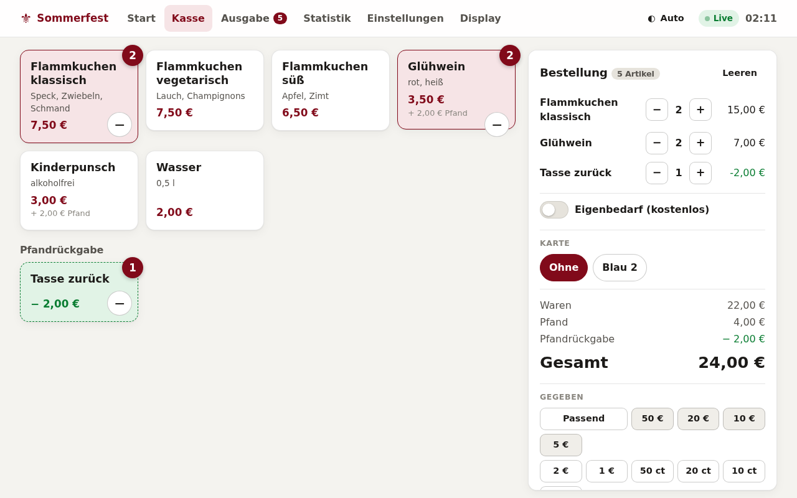
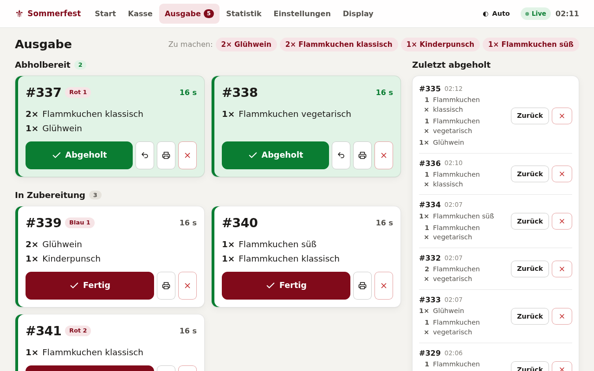
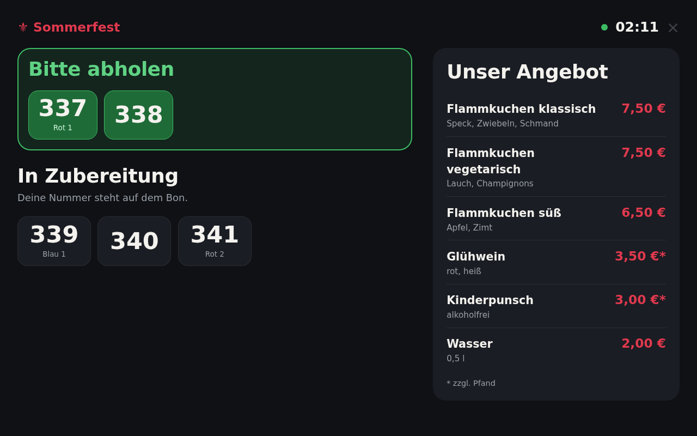
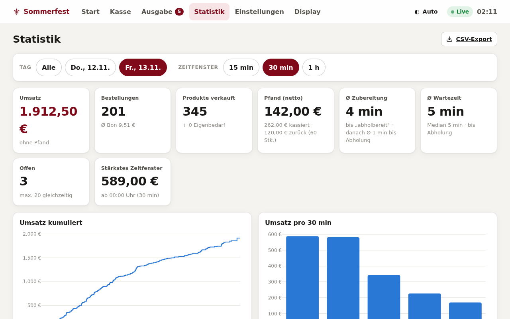

# Kasse – lokales Kassen- & Bestellsystem für Stände und Feste

[](https://github.com/obelix58143/kassensytem_dpsg_local/actions/workflows/tests.yml)

Ein einfaches, robustes Kassensystem für Essens- und Getränkestände (Weihnachtsmarkt, Sommerfest,
Lagerfeuer-Abend …). Läuft komplett **lokal ohne Internet** auf einem Laptop oder Raspberry Pi;
Kasse, Ausgabe und Kundendisplay sind beliebige Geräte mit Browser im selben WLAN und werden
**live synchronisiert**.



## Funktionen

- **Kasse** – große Produktkacheln für Touch, Warenkorb, Rückgeld-Rechner, Eigenbedarf,
  optionale Karten/Marken (z.B. Tischnummer), Tastatur: Enter = aufgeben, Esc = leeren
- **Pfandrückgabe** – eigener Produkttyp, frei wählbare Beträge, mischbar mit normalen Produkten
- **Ausgabe** – offene Bestellungen mit Wartezeit-Ampel, „Abgeholt", Rückgängig, Storno, Nachdruck;
  Übersicht „was ist noch zu machen"
- **Optionaler Schritt „Abholbereit"** – Ausgabe tippt „Fertig", das Kundendisplay zeigt „Bitte abholen"
- **Kundendisplay** – Vollbild-Ansicht mit Nummern und Angebot (Doppelklick = Vollbild)
- **Statistik** – Umsatz, Produkte, Wartezeiten, Pfand – live, als interaktive Charts; CSV-Export
- **Bondrucker** (ESC/POS) – USB oder Netzwerk, 58/80 mm, Kopf-/Fußzeile, Logo, Sprüche,
  „jede N-te Bestellung gewinnt", alles in der Oberfläche einstellbar und abschaltbar
- **Robust** – automatische Wiederverbindung bei WLAN-Aussetzern, keine doppelten Bestellungen
  bei Timeouts, Preise werden serverseitig berechnet, jede bestätigte Buchung überlebt auch einen
  harten Absturz, automatische Sicherungen alle 5 Minuten
- **Akku-Anzeige** – läuft die Kasse auf einem Laptop, zeigen alle Geräte oben dessen Akkustand;
  Warnung, wenn der Strom weg ist oder der Akku zur Neige geht
- **Läuft auf alten Tablets** – getestet bis zu einem Android-7-Browser (Chrome/WebView ab Version 53)

| Ausgabe (mit „Abholbereit") | Kundendisplay | Statistik |
|---|---|---|
|  |  |  |

## Schnellstart

Voraussetzungen: Linux (z.B. Raspberry Pi OS, Debian, Ubuntu) mit **Python ≥ 3.11** (inkl. `python3-venv`,
getestet bis 3.15) und **Node.js ≥ 20.19** (nur zum einmaligen Bauen der Oberfläche, getestet mit 26 LTS).

```bash
git clone https://github.com/obelix58143/kassensytem_dpsg_local.git kasse
cd kasse
./start_server.sh
```

Das Skript legt beim ersten Start eine virtuelle Python-Umgebung an, installiert die Abhängigkeiten,
baut die Oberfläche und startet den Server auf Port 5000.

Dann auf jedem Gerät im gleichen Netz `http://<IP-des-Servers>:5000` öffnen
(IP herausfinden: `hostname -I`) und die Station wählen:

| Station | Adresse |
|---|---|
| Kasse | `http://<IP>:5000/#/kasse` |
| Ausgabe | `http://<IP>:5000/#/ausgabe` |
| Kundendisplay | `http://<IP>:5000/#/front` |
| Statistik | `http://<IP>:5000/#/statistik` |
| Einstellungen | `http://<IP>:5000/#/settings` |

**Erste Schritte:** Einstellungen öffnen → Name der Kasse eintragen → Produkte anlegen
(„+ Produkt", ggf. „+ Pfandrückgabe") → optional Karten anlegen → los geht's.

## Bondrucker

Unterstützt werden ESC/POS-Bondrucker (die meisten günstigen 58- und 80-mm-Thermodrucker).
Alles Weitere unter **Einstellungen → Bondrucker** (an/aus, Verbindung, Papierbreite, Bon-Inhalt, Testdruck).

- **USB:** Drucker erscheint meist als `/dev/usb/lp0`. Der Benutzer, unter dem der Server läuft,
  braucht Schreibrechte – in der Regel genügt `sudo usermod -aG lp $USER` (danach neu anmelden).
- **Netzwerk:** IP-Adresse des Druckers eintragen, Port meist `9100`.
- **Logo:** in den Einstellungen hochladen (PNG/JPG) – wird automatisch schwarz-weiß und auf die
  Papierbreite verkleinert.
- **Sprüche:** direkt in den Einstellungen bearbeiten (ein Spruch pro Absatz). Die mitgelieferte
  Liste `printer_files/sprueche.json` ist nur der Startwert.

Ist kein Drucker angeschlossen, funktioniert alles weiter – die Kasse zeigt nur einen Hinweis,
und Bons lassen sich später in der Ausgabe nachdrucken.

## Autostart (systemd)

Damit die Kasse nach einem Stromausfall von selbst wieder läuft: Vorlage
[`docs/kasse.service`](docs/kasse.service) anpassen (Benutzer und Pfad) und einrichten:

```bash
sudo cp docs/kasse.service /etc/systemd/system/kasse.service
sudo systemctl daemon-reload
sudo systemctl enable --now kasse
```

## Netzwerk-Tipps

- Am zuverlässigsten ist ein **eigener WLAN-Router** am Stand (ohne Internet) – oder der
  Raspberry Pi selbst als Access Point.
- Gibt es kurz kein WLAN, zeigt jedes Gerät oben ein rotes Banner und verbindet sich automatisch
  wieder. Eine Bestellung, deren Antwort verloren ging, kann gefahrlos erneut abgeschickt werden –
  es entsteht keine doppelte Bestellung.
- **Windows mit WSL2:** Standardmäßig ist der Server nur auf dem PC selbst erreichbar. Für andere
  Geräte in `%UserProfile%\.wslconfig` unter `[wsl2]` die Zeile `networkingMode=mirrored`
  eintragen, WSL neu starten und Port 5000 in der Windows-Firewall freigeben.

## Daten, Sicherungen & Stromausfall

- Alle Daten (inkl. Einstellungen und Logo) liegen in einer SQLite-Datei `data.db` im Programmordner –
  immer dort, egal aus welchem Ordner der Server gestartet wird (andere Datei: `KASSE_DB=/pfad/data.db`).
- **Stromausfall/Absturz:** Jede Buchung wird auf die Platte geschrieben, *bevor* die Kasse „OK" bekommt
  (SQLite WAL + `synchronous=FULL`). Getestet: mehrfaches hartes Abschießen des Servers mitten im
  Betrieb – keine bestätigte Bestellung ging verloren.
- **Automatische Sicherungen** nach `backups/`: beim Start, alle 5 Minuten (nur wenn sich etwas
  geändert hat) und beim Beenden; die letzten 72 werden behalten. Jede Sicherung wird vor dem
  Speichern auf Fehlerfreiheit geprüft. Tipp: `KASSE_BACKUP_DIR` auf einen USB-Stick zeigen lassen.
- **Selbstheilung beim Start:** Ist die Datenbank nach einem Stromausfall beschädigt, wird sie
  beiseitegelegt (`data.db.kaputt-…`) und automatisch die neueste fehlerfreie Sicherung eingespielt.
- **Einstellungen → Daten & Sicherungen:** „Jetzt sichern", Datenbank herunterladen (z.B. aufs Handy),
  CSV-Export aller Bestellungen.
- **Wiederherstellen:** Server stoppen, gewünschte Datei aus `backups/` als `data.db` in den
  Programmordner kopieren (alte `data.db-wal`/`data.db-shm` vorher löschen), Server starten.
- Vor jeder Schema-Aktualisierung und vor „Hard Reset" wird zusätzlich `data.db.<grund>-<datum>.bak` angelegt.
- Für eine neue Veranstaltung: Einstellungen → „Hard Reset" – löscht Bestellungen, Produkte und Karten,
  behält die Einstellungen (Name, Drucker, Logo, Sprüche).

### Umgebungsvariablen

| Variable | Standard | Bedeutung |
|---|---|---|
| `PORT` | `5000` | Port des Servers |
| `KASSE_DB` | `./data.db` | Datenbankdatei |
| `PRINTER_DEV` | – | Druckergerät fest vorgeben (überschreibt die Einstellung) |
| `KASSE_DIST` | `frontend/dist` | Ordner der gebauten Oberfläche |
| `KASSE_BACKUP_DIR` | `./backups` | Ordner für automatische Sicherungen |
| `KASSE_BACKUP_MINUTEN` | `5` | Abstand der Sicherungen (0 = aus) |
| `KASSE_BACKUP_BEHALTEN` | `72` | Anzahl aufbewahrter Sicherungen |

## Entwicklung

```bash
python3 -m venv venv && ./venv/bin/pip install -r requirements-dev.txt
./venv/bin/python main.py           # Backend auf :5000
cd frontend && npm ci && npm run dev  # Oberfläche mit Hot-Reload auf :5173 (leitet /api und /ws an :5000)
```

### Tests

Bei jedem Push laufen alle Tests automatisch auf GitHub (Actions → „Tests"): Backend mit Python 3.11
(Raspberry Pi OS Bookworm), 3.13 (Trixie) und 3.15, Bau der Oberfläche mit Node 26 LTS und die
Browser-Tests (normal und als alter Android-Browser).
Lokal:

```bash
./venv/bin/python -m pytest tests                 # Backend: Migration, API, Pfand, Nebenläufigkeit,
                                                  # WebSocket, Drucker, Absturz (kill -9), Sicherungen
./venv/bin/playwright install chromium
./venv/bin/python tests/e2e.py                    # Browser: mehrere Geräte, Konflikte, Offline, …
./venv/bin/python tests/e2e.py --sim-alt          # dasselbe als simulierter alter Android-Browser
```

### Aufbau

- **Backend** (`main.py`, `flaskserver.py`, `database.py`, `printer.py`): Flask + flask-sock, SQLite (WAL).
  Änderungen über REST (`POST/PUT/DELETE /api/...`, JSON); nach jeder Änderung schickt der Server den
  kompletten Zustand per WebSocket (`/ws`) an alle Geräte (Heartbeat alle 15 s).
- **Frontend** (`frontend/`): Vue 3 + Vite, gebaut als Legacy-Bundle (läuft auch auf alten WebViews),
  Fallback-CSS in `frontend/src/compat.css`. Statistiken werden im Browser berechnet (`stats.js`) und
  mit Plotly gezeichnet – alles lokal gebündelt, kein CDN.
- **Beträge** in Cent; Preis und Pfand werden serverseitig berechnet und je Position gespeichert,
  spätere Preisänderungen verändern keine alten Umsätze.
- **Migrationen** laufen beim Start automatisch in einer einzigen Transaktion (mit Backup).

### API (Kurzüberblick)

| Methode | Pfad | Body |
|---|---|---|
| GET | `/api/state` | – |
| POST | `/api/bestellungen` | `{produkte:[{id,anzahl}], karte, eigenbedarf, client_ref}` |
| PUT | `/api/bestellungen/<id>/status` | `{status: "bestellt"\|"bereit"\|"abgeholt"}` |
| DELETE | `/api/bestellungen/<id>` | Storno |
| POST | `/api/bestellungen/<id>/bon` · `/nummer` | Nachdruck |
| POST/PUT/DELETE | `/api/produkte[/<id>]` | `{name, beschreibung, preis_cent, pfand_cent, aktiv, sortierung, typ: "normal"\|"pfand"}` |
| POST/PUT/DELETE | `/api/karten[/<id>]` | `{beschreibung}` |
| GET / PUT | `/api/einstellungen` (über `/api/state`) | z.B. `{titel, bereit_aktiv, drucker_aktiv, bon_kopf, …}` |
| GET | `/api/system` | Akkustand des Kassen-Rechners (`null` ohne Akku) |
| GET · POST | `/api/drucker` · `/api/drucker/test` | Status · Testdruck |
| PUT · GET · DELETE | `/api/drucker/logo` (GET: `/api/drucker/logo.png`) | Bilddatei als Body |
| GET · POST | `/api/sicherungen` · `/api/sicherungen/download` | Liste/jetzt sichern · DB-Datei |
| GET | `/api/export.csv` | – |
| POST | `/api/reset` | `{bestaetigung: "RESET"}` |

**Hinweis:** Es gibt keine Anmeldung – jeder im selben Netz kann die Oberfläche bedienen.
Den Server deshalb nur in einem vertrauenswürdigen (Stand-)WLAN betreiben, nicht im Internet.

## Mitwirkende

- [Sallavati](https://github.com/Sallavati) – ursprüngliche Version
- [obelix58143](https://github.com/obelix58143)

## Lizenz

[MIT](LICENSE) – frei nutzbar, veränderbar und weitergebbar, auch kommerziell; ohne Gewähr.
